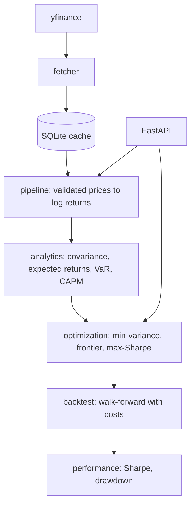

# Quantitative Portfolio Optimizer

[](https://github.com/martintodev/quant-portfolio-optimizer/actions/workflows/ci.yml)

Python/SQL portfolio optimizer with mean-variance optimization, risk analysis (VaR and Expected Shortfall), and walk-forward backtesting, structured as an installable package with a small FastAPI service.

> This is a portfolio project for learning and demonstration. It is not investment advice.

## What it does

- **Data pipeline:** fetches daily prices from yfinance, caches them in SQLite, and validates missing data before anything is computed.
- **Optimization:** minimum-variance and maximum-Sharpe portfolios with cvxpy, plus the efficient frontier. Long-only and fully invested.
- **Risk:** historical, parametric, and Monte Carlo VaR, Expected Shortfall, CAPM beta, Sharpe ratio, and maximum drawdown.
- **Backtesting:** walk-forward re-optimization with transaction costs, compared against an equal-weight benchmark.
- **API:** a FastAPI service exposing the optimizer, with interactive documentation. Data and solver failures return 422 with an error code and a detail message.

## Architecture



```
src/qpo/
  data/          fetcher.py (yfinance), storage.py (SQLite cache)
  analytics/     returns.py, risk.py (covariance, VaR, Expected Shortfall, CAPM)
  optimization/  mean_variance.py (cvxpy optimizers, Sharpe ratio)
  backtest/      engine.py (walk-forward), performance.py (drawdown, rolling Sharpe)
  api/           main.py (FastAPI), schemas.py (request and response models), service.py
  pipeline.py    prices to validated returns
tests/           unit tests; the network is mocked, so they run offline
docs/            findings.md
scripts/         backtest_report.py (reproduces the results below)
```

## Getting started

Requires Python 3.12 or newer. CI runs the tests on 3.12, 3.13, and 3.14.

```bash
git clone https://github.com/martintodev/quant-portfolio-optimizer.git
cd quant-portfolio-optimizer
python -m venv venv
source venv/bin/activate        # Windows PowerShell: venv\Scripts\Activate.ps1
pip install -e ".[dev]"
```

Run the tests and the type checker:

```bash
pytest
python -m mypy src
```

### Run the API

```bash
uvicorn qpo.api.main:app --reload
```

Open http://127.0.0.1:8000/docs for interactive documentation. Current endpoints:

- `GET /health`
- `POST /optimize` takes tickers, a date range, and a strategy (`min_variance` or `max_sharpe`), and returns weights, expected return, volatility, and Sharpe ratio (`null` when it is undefined).
- `POST /frontier` takes tickers, a date range, and the number of points (5 to 50, default 20), and returns the efficient frontier as a list of points, each with expected return, volatility, and weights. `requested_points` reports how many were asked for, because infeasible points are dropped and fewer may come back.

```bash
curl -X POST http://127.0.0.1:8000/optimize \
  -H "Content-Type: application/json" \
  -d '{"tickers": ["AAPL", "MSFT"], "start": "2023-01-01", "end": "2024-01-01", "strategy": "min_variance"}'
```

The first request downloads prices from yfinance. Later requests for the same range use the SQLite cache.

### Reproduce the backtest results

```bash
python scripts/backtest_report.py slice   # quick smoke test on a short window
python scripts/backtest_report.py full    # the full run reported below
```

The first run downloads about seven years of prices for six tickers. The max-Sharpe backtest takes roughly 15 to 20 seconds.

## Results

Six large caps (AAPL, MSFT, JPM, XOM, JNJ, PG), 60 monthly rebalances over about five years, a 504-day lookback, 10 bps transaction costs, long-only.

| Strategy     | Ending $1 | Annual return | Annual vol | Sharpe | Max drawdown | Avg turnover |
| ------------ | --------- | ------------- | ---------- | ------ | ------------ | ------------ |
| Min-variance | 1.47      | 7.7%          | 13.0%      | 0.362  | 15.3%        | 0.051        |
| Max-Sharpe   | 1.87      | 12.6%         | 21.4%      | 0.449  | 20.2%        | 0.346        |
| Equal-weight | 2.11      | 14.9%         | 14.3%      | 0.835  | 16.0%        | n/a          |

Neither optimizer beat the equal-weight benchmark on Sharpe ratio in this sample. The tickers were chosen by hand and the window is a single five-year period, so treat this as a description of one backtest and not a general conclusion. The equal-weight benchmark rebalances daily at no cost, which flatters it slightly.

## Design notes

- **No lookahead.** Each rebalance uses only the 504 trading days before it. Tests change the data after a rebalance and check that earlier results do not move, and a one-row leak is caught by a dedicated test.
- **Failures are explicit.** Specific exceptions (`SolverError`, `DataError`) separate solver and data problems from bugs. A non-optimal solve is rejected, and the backtest keeps its previous weights and reports how many times that happened.
- **Cache.** SQLite with a composite primary key on ticker and date, so repeated fetches cannot create duplicate rows.
- **Typed and tested.** mypy runs with `disallow_untyped_defs` in CI, alongside the test suite on three Python versions.
- **Data source.** yfinance is an unofficial Yahoo Finance wrapper, so availability and data quality can change. The fetcher sits behind a small interface so the source can be swapped.

## Future improvements

**Planned**

- API endpoints for the risk metrics, and backtests
- A Dockerfile, with the database path made configurable
- A dashboard on top of the API

**Research ideas**

- Weight caps or covariance shrinkage to reduce concentration (max-Sharpe held about 71% in its largest position on average)
- A turnover penalty in the optimizer, since max-Sharpe turned over about 35% of the portfolio per rebalance
- A larger, systematically chosen universe and several sample periods, to address the hand-picked tickers and single window

### Research & Methodology

For a deep dive into the portfolio optimization results, mathematical limitations, and backtest robustness checks, see [findings.md](docs/findings.md).
